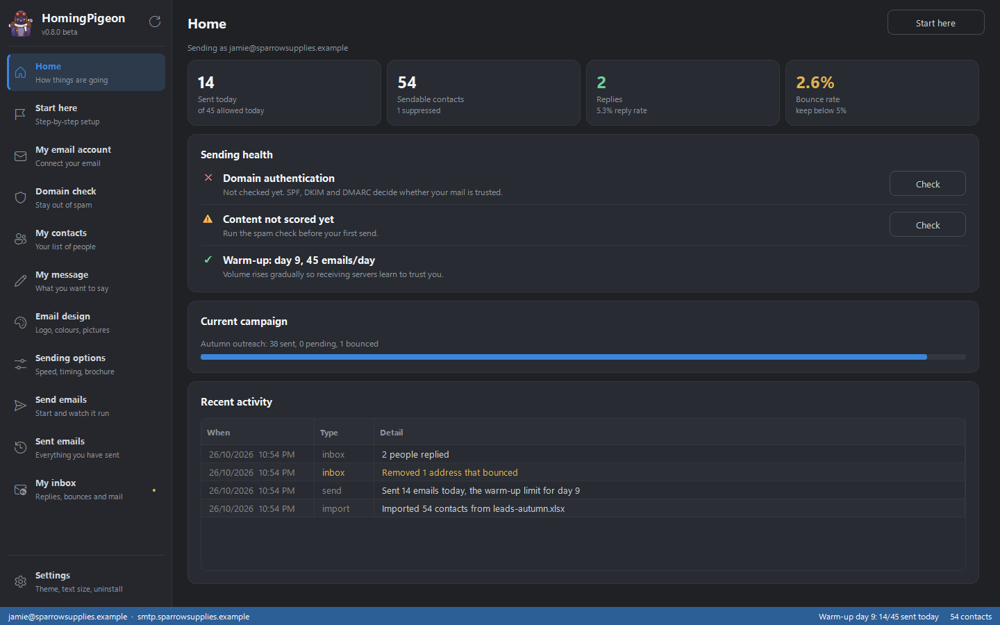
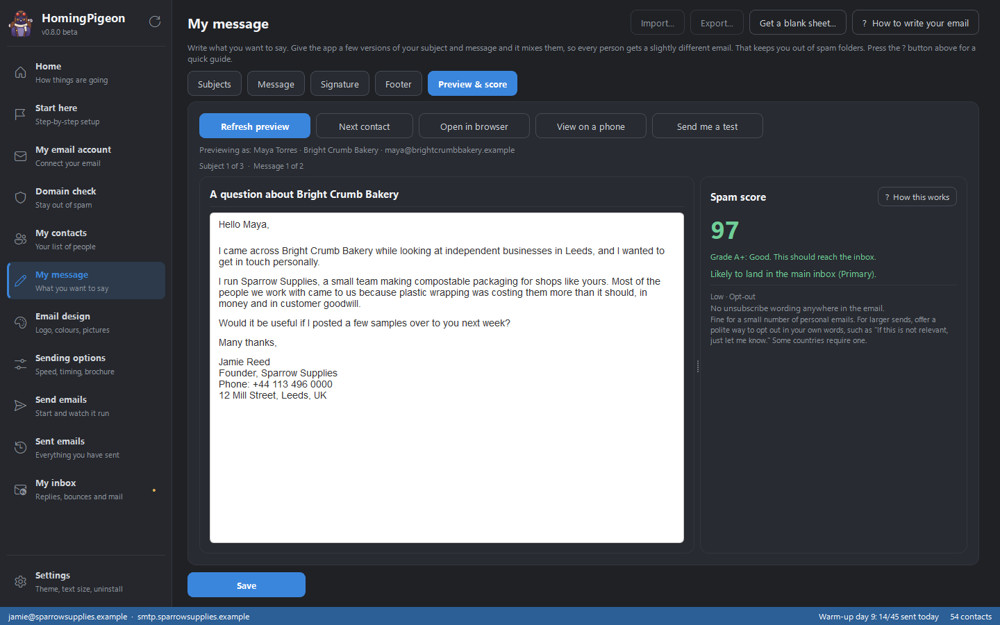
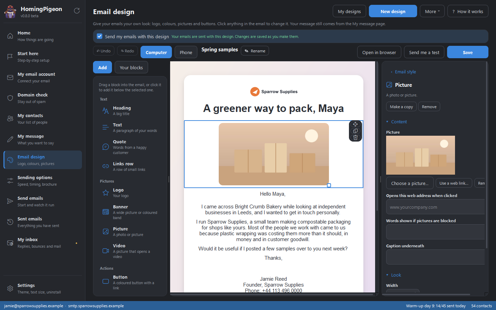
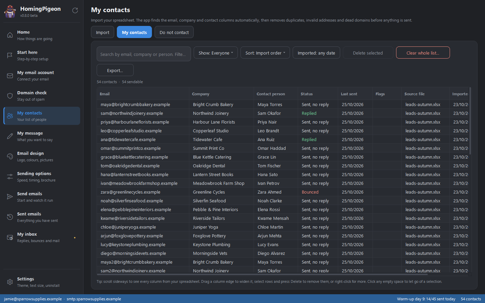
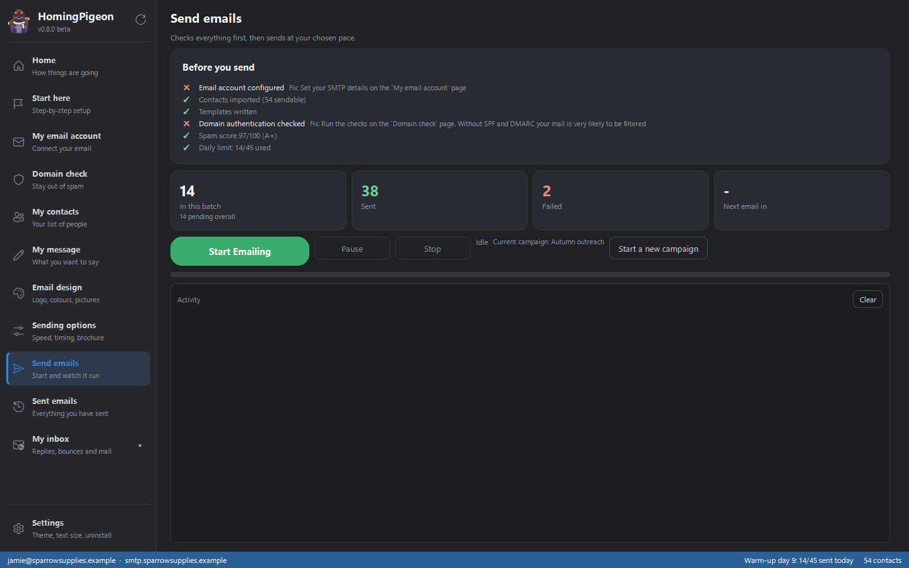
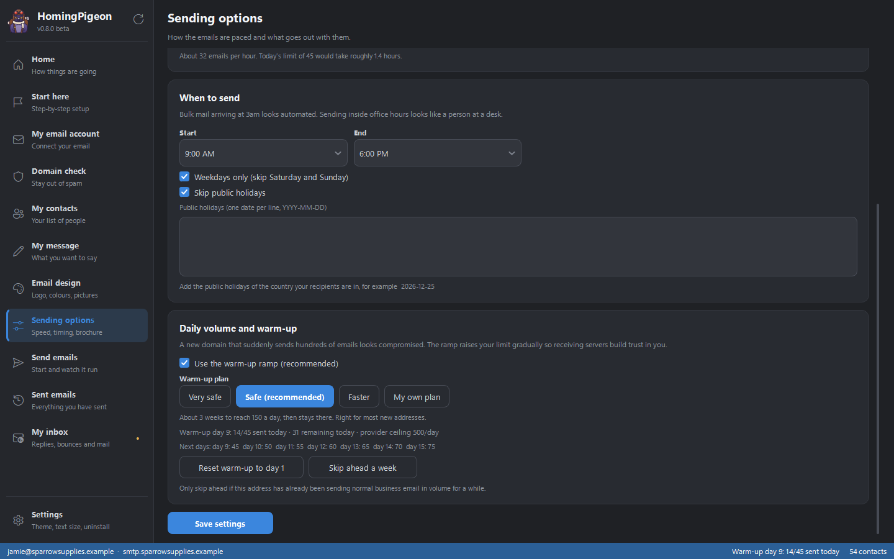
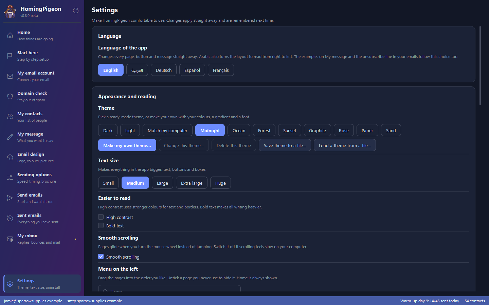
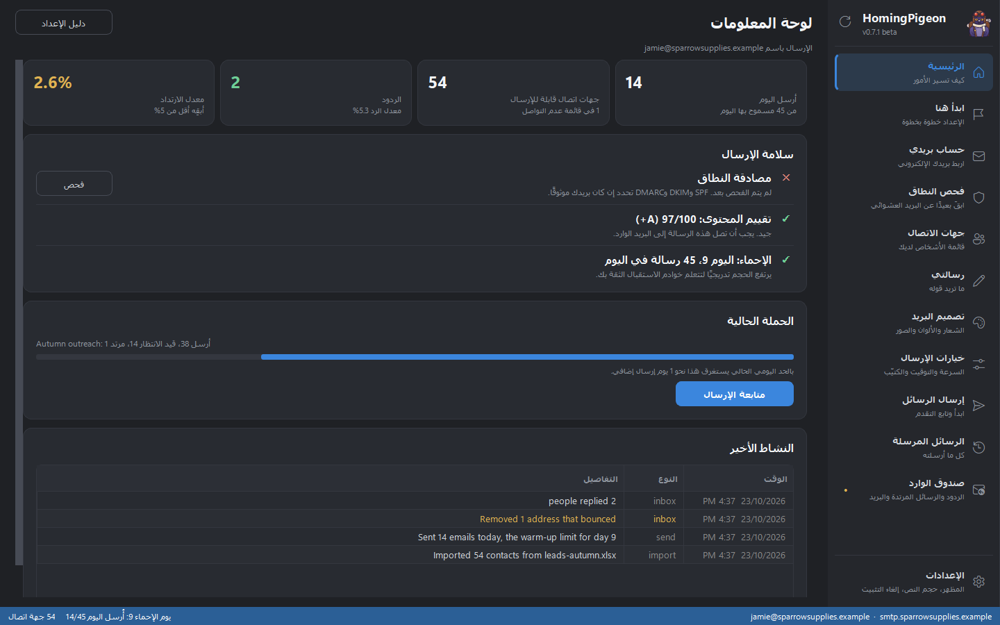

<p align="center">
  
</p>

<h1 align="center">HomingPigeon</h1>

<p align="center"><b>Safe, simple email for your business.</b></p>

<p align="center">
  <a href="../../releases/latest"><b>Download</b></a> ·
  Version 0.8.0 (free beta) · Windows, Mac and Linux ·
  English, العربية, Deutsch, Español, Français
</p>

Send personal outreach email to your contact list without landing in spam or getting your
domain blacklisted. HomingPigeon checks your domain, cleans your list, makes every email
slightly different, sends at a human pace and removes addresses that bounce. It runs on your
own computer, and your contacts never leave it.



## What it does

- **Spam score before you send.** See exactly what one contact will receive, a score out of 100,
  where it will land (main inbox, Promotions or spam) and what to change.
- **Nobody gets the same email twice.** Every person is remembered, so stopping, restarting or
  importing the same sheet again never sends a second copy.
- **Clean lists.** Open an Excel or CSV file: the app finds the right columns and removes
  duplicates, bad addresses and dead domains. Every other column becomes a tag like `{{City}}`.
- **Warm-up and human pacing.** A daily limit that grows safely, random gaps between emails,
  office hours only, weekends and holidays skipped, and an automatic stop if bounces rise.
- **Bounces and replies handled.** Your inbox is checked in the background; bounces and
  unsubscribe requests are removed for good, and replies can be read in the app.
- **Domain check.** Checks SPF, DKIM and DMARC and writes the records for you.
- **Write like in Outlook, design like in Canva.** Formatting, signatures with your logo, a
  footer, and a drag-and-drop email designer with ready-made starting designs.
- **Make it yours.** Eleven themes or your own colours, gradient and font. Five languages,
  with Arabic reading right to left. Updates itself, keeps backups.

## Screenshots

| | |
|---|---|
|  |  |
| **Spam score.** The finished email for a real contact, and where it will land. | **Email design.** Drag blocks in, type straight onto the email, resize pictures. |
|  |  |
| **My contacts.** Each person's status and when they were last emailed. | **Send emails.** A checklist first, then sending you can pause any time. |
|  |  |
| **Warm-up and timing.** A safe daily plan and office hours only. | **Themes.** Pick one or make your own and share it as a file. |


**In your language.** English, Arabic, German, Spanish or French; Arabic mirrors the whole app.

## Install

**Windows.** Download `HomingPigeon-v0.8.0.zip` from [Releases](../../releases/latest),
right-click it, **Extract All**, then double-click **`HomingPigeon Setup.exe`** and click
**Install**. No administrator password needed.

- *"Windows protected your PC"*: click **More info**, then **Run anyway**.
- *"Smart App Control blocked an app"*: right-click
  **`Install HomingPigeon (if Setup is blocked).bat`**, **Properties**, tick **Unblock**, **OK**,
  then double-click it.

**Mac or Linux.** Download **Source code (zip)** from [Releases](../../releases/latest), unzip
it and double-click **`Start HomingPigeon - Mac.command`** or **`Start HomingPigeon - Linux.sh`**.
The first start takes a few minutes while it gets ready.

**Updates** are automatic: when a new version is out, click **Update now**. Your contacts,
messages and settings are always kept.

## Getting started

The app opens empty. Go to **Start here** and follow it from the top: it ticks each step off
as you go. You need an email address on your own domain (like `you@yourcompany.com`), and if
your email uses two-step sign-in, an **app password** (the app shows where to get one).

## Your data

Everything stays on your computer, in a folder separate from the app, so updating or removing
it never touches your data. Your email password is stored encrypted. The app only talks to
your own email provider and to public DNS.

## For developers

PyQt6 desktop app. Business rules live in `app/core/` (no UI imports, unit tested); anything
slow runs in `app/workers/`, never on the UI thread. Start with
[`docs/handover/README.md`](docs/handover/README.md).

```
pip install -r requirements-dev.txt
python run.py                       # run the app
python -m pytest tests/ -q          # tests
python tools/take_screenshots.py    # these screenshots, from made-up data
python tools/build_installer.py     # the release zip
```

To release: change `APP_VERSION` in `app/config.py`, push, and publish a GitHub release with a
new tag. GitHub Actions builds and attaches the zip.

## Responsibility

You are responsible for who you email and for following the law where you and your recipients
live (GDPR, CAN-SPAM and similar). HomingPigeon helps you send responsibly; it does not make
unsolicited email legal.

Free while in beta. Please [report anything confusing or broken](../../issues/new).
